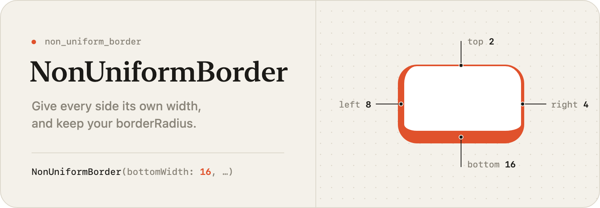
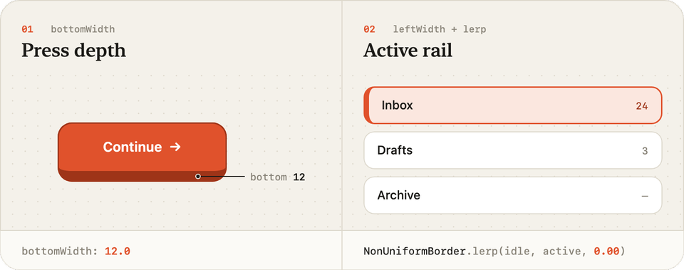
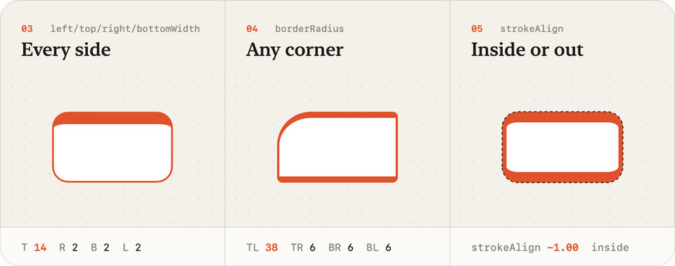

<p align="center">
  
</p>

# Non-Uniform Border for Flutter

A lightweight `ShapeBorder` for Flutter that supports **independent side widths**, **mixed `BorderRadius` corners**, **`strokeAlign`**, and **smooth `lerp()` animations** with a single color — avoiding Flutter's runtime `Border` crash when non-uniform border widths are combined with `borderRadius`.

> **Why not Flutter's `Border`?**
> `BoxDecoration(border: Border(...), borderRadius: ...)` asserts at runtime unless every side has the same width and color. `NonUniformBorder` is a drop-in `ShapeBorder` for `ShapeDecoration` (and `Container` / `AnimatedContainer`) with zero crashes.

<p align="center">
  
</p>

## Getting Started

Add `non_uniform_border` to your `pubspec.yaml`:

[](https://pub.dev/packages/non_uniform_border)

```yaml
dependencies:
  non_uniform_border: ^1.0.1
```

## Usage

Import `package:non_uniform_border/non_uniform_border.dart` and pass `NonUniformBorder` to any `ShapeDecoration`:

```dart
import 'package:flutter/widgets.dart';
import 'package:non_uniform_border/non_uniform_border.dart';

// Independent side widths + asymmetric BorderRadius
const shapeBorder = NonUniformBorder(
  leftWidth: 4,
  topWidth: 12,
  rightWidth: 8,
  bottomWidth: 16,
  color: Color(0xFFFBBF24),
  strokeAlign: BorderSide.strokeAlignCenter,
  borderRadius: BorderRadius.horizontal(
    left: Radius.circular(24),
    right: Radius.circular(48),
  ),
);

Widget example = DecoratedBox(
  decoration: const ShapeDecoration(
    color: Color(0xFFFEF3C7),
    shape: shapeBorder,
  ),
  child: const SizedBox(width: 240, height: 120),
);
```

### Constructors & Helpers

- **`NonUniformBorder(...)`** — set `leftWidth`, `topWidth`, `rightWidth`, `bottomWidth`, `color`, `strokeAlign` (`BorderSide.strokeAlignInside`, `strokeAlignCenter`, `strokeAlignOutside`), and `borderRadius`.
- **`NonUniformBorder.symmetric(verticalWidth: ..., horizontalWidth: ...)`** — mirror top/bottom and left/right widths cleanly.
- **`NonUniformBorder.all(width: ...)`** — uniform border on all sides.
- **`NonUniformBorder.fromBorderSide(side)`** — build directly from a Flutter `BorderSide`.
- **`copyWith(...)`** — derive variations cleanly (for example, animating a 3D button press with `bottomWidth`).
- **Smooth Animations** — `ShapeBorder.lerp`, `AnimatedContainer`, and `ShapeBorderTween` smoothly interpolate side widths, `borderRadius`, `strokeAlign`, and `color`.

## Properties in Motion

<p align="center">
  
</p>

## Contributions

Issues and pull requests are welcome on [GitHub](https://github.com/bernaferrari/non_uniform_border).

## License

Released under the [MIT License](LICENSE).
